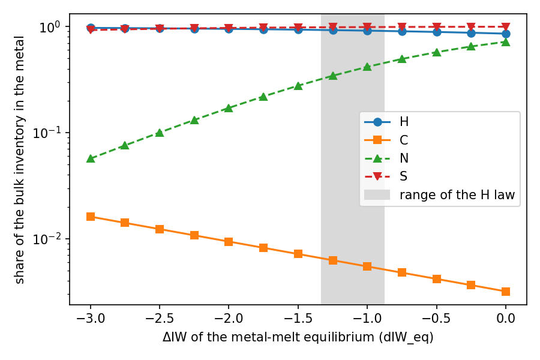

# Metal reservoir: partition volatiles into the core

This tutorial adds a metal reservoir to a CALLIOPE solve. The metal stands for the liquid iron that forms a planet's core. Some of the H, C, N and S of the melt goes into this metal, so less of it is left for the atmosphere.

By the end of it you will:

- have run the same planet without metal and with metal, and compared the results;
- know the 2 ways to set the oxygen fugacity of the metal-melt equilibrium (`dIW_eq_mode`);
- know the 2 ways to set the O and Si of the metal (`O_mode_core`, `Si_mode_core`), and how to read the FeO exchange;
- know what the out-of-range flags and the placeholder warning mean, and what to do about them;
- have made a plot of the share of each element in the metal against $\Delta\mathrm{IW}$;
- have run the authoritative-O solve with metal.

You should already have done the [First run](firstrun.md) tutorial. The physics is on the [Metal reservoir](../Explanations/metal.md) explanation page, and every input and output key is on the [partition file reference](../Reference/partition_file.md). The whole tutorial runs in about 1 minute.

## Step 1: the input

Start from the input of the First run tutorial and add the metal keys:

```python
import logging

import matplotlib.pyplot as plt
import numpy as np

from calliope.constants import M_core_earth, volatile_species
from calliope.solve import (
    equilibrium_atmosphere,
    equilibrium_atmosphere_authoritative_O,
    get_target_from_params,
)

logging.basicConfig(level=logging.WARNING, format='%(levelname)s %(message)s')

ddict = {
    # planet and melt, as in the First run tutorial
    'M_mantle': 4.03e24,  # kg
    'gravity': 9.81,  # m s-2
    'radius': 6.371e6,  # m
    'T_magma': 2500.0,  # K
    'Phi_global': 1.0,  # fully molten
    'fO2_shift_IW': 0.5,  # surface gas and melt, relative to the IW buffer
    'hydrogen_earth_oceans': 1.0,
    'CH_ratio': 0.1,
    'nitrogen_ppmw': 2.0,
    'sulfur_ppmw': 200.0,
}
for sp in volatile_species:
    ddict[f'{sp}_included'] = 1
    ddict[f'{sp}_initial_bar'] = 0.0

metal = {
    'metal_mass': M_core_earth,  # kg, the whole Earth core (1.94e24 kg)
    'P_eq': 50.0,  # GPa
    'T_eq': 3500.0,  # K
    'dIW_eq_mode': 'parameter',
    'dIW_eq': -1.0,  # log10 units relative to the IW buffer
}
target = get_target_from_params(ddict)
```

The metal keys:

- `metal_mass` (kg) is the metal that is in equilibrium with the present melt. Here it is the whole Earth core, in equilibrium with the whole mantle at one pressure and temperature (the single-stage case; the [explanation page](../Explanations/metal.md#worked-example) says why). Any value above 0 turns the metal reservoir on.
- `P_eq` (GPa) and `T_eq` (K) are the pressure and temperature of the metal-melt equilibrium. They are not the surface values: the metal equilibrates deep in the magma ocean.
- `dIW_eq` (log10 units) is the oxygen fugacity of that equilibrium relative to the iron-wüstite (IW) buffer. It is a separate input from `fO2_shift_IW`, which sets the gas and the melt at the surface.

The logging line makes the warnings of CALLIOPE visible. You need them in step 5.

## Step 2: solve without metal and with metal

```python
np.random.seed(0)
no_metal = equilibrium_atmosphere(target, {**ddict, 'metal_mass': 0.0}, print_result=False)
with_metal = equilibrium_atmosphere(target, {**ddict, **metal}, print_result=False)

print(f"P_surf: {no_metal['P_surf']:.3g} bar without metal, {with_metal['P_surf']:.3g} bar with metal")
print('el  D_metal  w_core     kg_core    kg_total   bulk       core share')
for el in ('H', 'C', 'N', 'S'):
    core, total = with_metal[f'{el}_kg_core'], with_metal[f'{el}_kg_total']
    print(
        f"{el:2s}  {with_metal[f'{el}_D_metal']:<7.4g}  {with_metal[f'w_{el}_core']:.3e}  "
        f'{core:.3e}  {total:.3e}  {core + total:.3e}  {core / (core + total):.4f}'
    )
```

The output:

```text
P_surf: 8.7 bar without metal, 7.67 bar with metal
el  D_metal  w_core     kg_core    kg_total   bulk       core share
H   22.14    7.304e-05  1.417e+20  1.330e+19  1.550e+20  0.9142
C   0.08284  4.384e-08  8.505e+16  1.541e+19  1.550e+19  0.0055
N   39       1.733e-06  3.362e+18  4.698e+18  8.060e+18  0.4172
S   173      4.105e-04  7.964e+20  9.565e+18  8.060e+20  0.9881
```

How to read the columns:

- `<e>_D_metal` is the partition coefficient $D$ on the mass basis: the mass fraction of the element in the metal divided by that in the melt.
- `w_<e>_core` is the mass fraction of the element in the metal, and `<e>_kg_core` its mass there, in kg.
- `<e>_kg_total` is the gas plus the melt. It does not include the metal.
- The bulk inventory of an element is `<e>_kg_total + <e>_kg_core`. It equals the budget in `target`: no mass is lost or made.

Most of the H and S goes into the metal, and almost no C. The atmosphere of this planet is mostly CO and CO$_2$, so the surface pressure falls only from 8.7 to 7.67 bar.

A solve with `metal_mass` = 0 is the solve without metal. Its result holds `<e>_kg_core` = 0 for H, C, N and S and none of the other metal keys:

```python
for el in ('H', 'C', 'N', 'S'):
    print(f"{el}: core {no_metal[f'{el}_kg_core']}, D_metal in result: {f'{el}_D_metal' in no_metal}")
```

```text
H: core 0.0, D_metal in result: False
C: core 0.0, D_metal in result: False
N: core 0.0, D_metal in result: False
S: core 0.0, D_metal in result: False
```

## Step 3: the 2 modes of $\Delta\mathrm{IW}$

`dIW_eq_mode` selects where the $\Delta\mathrm{IW}$ of the partition laws comes from:

- `'parameter'`: from `dIW_eq`, as in step 2.
- `'from_FeO'`: from the FeO of the melt and the Fe of the metal, $\Delta\mathrm{IW} = 2\log_{10}(x_\mathrm{FeO}/x'_\mathrm{Fe})$. Here $x_\mathrm{FeO}$ is the mole fraction of FeO in the melt on the single-cation basis, and $x'_\mathrm{Fe}$ the mole fraction of Fe in the metal without H and C. The melt composition is `silicate_oxides`, KLB-1 by default.

```python
from_feo = equilibrium_atmosphere(
    target, {**ddict, **metal, 'dIW_eq_mode': 'from_FeO'}, print_result=False
)
for name, res in (('parameter', with_metal), ('from_FeO', from_feo)):
    d_values = ', '.join(f"{el} {res[f'{el}_D_metal']:.3g}" for el in ('H', 'C', 'N', 'S'))
    flags = ''.join(el for el in ('H', 'C', 'N', 'S') if res[f'{el}_D_out_of_range'])
    print(f"{name:9s}  dIW_eq {res['dIW_eq']:+.3f}  D: {d_values}  flagged: {flags}")
```

```text
parameter  dIW_eq -1.000  D: H 22.1, C 0.0828, N 39, S 173  flagged: NS
from_FeO   dIW_eq -2.484  D: H 52, C 0.187, N 6.37, S 42.2  flagged: HNS
```

The result gives the $\Delta\mathrm{IW}$ it used as `dIW_eq`. With the KLB-1 melt (8.10 wt% FeO) and metal without O and Si, `'from_FeO'` gives $-2.48$. This is outside the range of the H law ($-1.33$ to $-0.88$), so H is flagged as well.

## Step 4: O and Si in the metal

O and Si enter the metal by exchange with the silicate: $\mathrm{FeO} = \mathrm{Fe} + \mathrm{O}$ and $\mathrm{SiO_2} + 2\,\mathrm{Fe} = \mathrm{Si} + 2\,\mathrm{FeO}$. `O_mode_core` and `Si_mode_core` select how CALLIOPE sets them:

- `'fixed'` (default): the metal holds `w_O_core` and `w_Si_core` (mass fractions, default 0).
- `'partition'`: the exchange coefficients of the partition file and the $\Delta\mathrm{IW}$ of each pass set them.

```python
fixed = equilibrium_atmosphere(
    target, {**ddict, **metal, 'w_O_core': 0.02, 'w_Si_core': 0.05}, print_result=False
)
partition = equilibrium_atmosphere(
    target,
    {**ddict, **metal, 'O_mode_core': 'partition', 'Si_mode_core': 'partition'},
    print_result=False,
)
for name, res in (('fixed', fixed), ('partition', partition)):
    ratio = res['n_FeO_exchange'] / res['n_FeO_silicate']
    print(
        f"{name:9s}  w_O {res['w_O_core']:.4f}  w_Si {res['w_Si_core']:.4f}  "
        f"n_FeO_exchange {res['n_FeO_exchange']:+.3e} mol ({ratio:+.2f} of the melt FeO)  "
        f"FeO_exchange_out_of_range {res['FeO_exchange_out_of_range']}  "
        f"D_C {res['C_D_metal']:.3g}"
    )
print('O and Si flags in partition mode:', partition['O_D_out_of_range'], partition['Si_D_out_of_range'])
```

```text
fixed      w_O 0.0200  w_Si 0.0500  n_FeO_exchange -4.482e+24 mol (-0.99 of the melt FeO)  FeO_exchange_out_of_range 1  D_C 0.298
partition  w_O 0.1366  w_Si 0.0027  n_FeO_exchange +1.619e+25 mol (+3.56 of the melt FeO)  FeO_exchange_out_of_range 1  D_C 430
O and Si flags in partition mode: 1 1
```

How to read the exchange:

- `n_FeO_exchange` (mol) is the FeO that the metal took from the melt: 1 FeO per O atom, minus 2 FeO per Si atom (the Si reaction gives FeO back). A negative value means that the metal gave FeO to the melt.
- `n_FeO_silicate` (mol) is the FeO of the melt.
- `FeO_exchange_out_of_range` is 1 when the exchange is more than 10 % of the melt FeO. CALLIOPE does not change the melt FeO, so such a result is not self-consistent. With the whole core as metal, a few wt% of O or Si already moves a large part of the melt FeO.

In `'partition'` mode the metal takes 13.7 wt% O. That needs 3.56 times the FeO that the melt has, which is not possible. The metal O also enters the C law through its composition term, and $D_\mathrm{C}$ rises from 0.0828 to 430. The O and Si of the metal come from the FeO of the rock, so they never enter the volatile O budget (see step 7).

## Step 5: read the warnings and the flags

The first solves of this tutorial logged these warnings (each one once per process):

```text
WARNING the metal partition laws are placeholders
WARNING N partition law evaluated outside its range or on an unknown range: P_eq 50 GPa, T_eq 3500 K, dIW_eq -1
WARNING S partition law evaluated outside its range or on an unknown range: P_eq 50 GPa, T_eq 3500 K, dIW_eq -1
WARNING H partition law evaluated outside its range or on an unknown range: P_eq 50 GPa, T_eq 3500 K, dIW_eq -2.48
WARNING the metal exchange takes more than 10 % of the silicate FeO (0.987); the melt FeO and dIW_eq of this solve do not follow it
WARNING O_mode_core 'partition' uses ideal activities in metal and melt; activity coefficients are not included
WARNING Si_mode_core 'partition' uses ideal activities in metal and melt; activity coefficients are not included
WARNING O partition law evaluated outside its range or on an unknown range: P_eq 50 GPa, T_eq 3500 K, dIW_eq -1
WARNING Si partition law evaluated outside its range or on an unknown range: P_eq 50 GPa, T_eq 3500 K, dIW_eq -1
```

What each one means, and what to do:

- **The laws are placeholders.** The packaged partition file has `placeholder = true`. Its laws come from published values, but some are simple lines through 2 table values. For a result you want to publish, put a fitted law from a source you have read into your own file: see [Add a new partition law](partition_law.md).
- **A law outside its range.** `<e>_D_out_of_range` is 1 and the warning names the conditions. The pressure, temperature or $\Delta\mathrm{IW}$ is outside the data that the law was fitted to, or the range is unknown. The placeholder N and S laws are in range only at one pressure and temperature (N: 20 GPa, 3000 K; S: 60 GPa, 4000 K). The placeholder O and Si laws have no known temperature and $\Delta\mathrm{IW}$ range, so they are always flagged. Move the conditions into the range, or use a law whose range covers them. If you keep the result, say in your text that the law was extrapolated.
- **The FeO exchange.** More than 10 % of the melt FeO moved. Use less metal O and Si, or apply the exchange to the FeO budget of your own model.
- **Ideal activities.** `'partition'` mode leaves out the activity coefficients of the published O and Si fits. Treat its O and Si as a first estimate.

The solve does not stop or clamp a value for any of these: it returns the result with the flags set. The flags are in the result dictionary, so a script can check them; the warnings appear only once per process.

## Step 6: a plot of the core share against $\Delta\mathrm{IW}$

Scan `dIW_eq` from $-3$ to 0 and plot the share of each element in the metal. Each solve starts from the partial pressures of the solve before (`p_guess`), which makes the scan faster:

```python
d_iw_grid = np.linspace(-3.0, 0.0, 13)
share = {el: [] for el in ('H', 'C', 'N', 'S')}
p_guess = None
for d_iw in d_iw_grid:
    res = equilibrium_atmosphere(
        target, {**ddict, **metal, 'dIW_eq': float(d_iw)}, p_guess=p_guess, print_result=False
    )
    p_guess = {s: res[f'{s}_bar'] for s in ('H2O', 'CO2', 'N2', 'S2')}
    for el in share:
        core = res[f'{el}_kg_core']
        share[el].append(core / (core + res[f'{el}_kg_total']))

fig, ax = plt.subplots(figsize=(6, 4))
for el, style in zip(share, ('o-', 's-', '^--', 'v--')):
    ax.plot(d_iw_grid, share[el], style, label=el)
ax.axvspan(-1.33, -0.88, color='0.85', label='range of the H law')
ax.set_xlabel(r'$\Delta\mathrm{IW}$ of the metal-melt equilibrium (dIW_eq)')
ax.set_ylabel('share of the bulk inventory in the metal')
ax.set_yscale('log')
ax.legend()
fig.tight_layout()
fig.savefig('metal_core_share.png', dpi=150)
for i in (0, 4, 8, 12):
    print(f"dIW_eq {d_iw_grid[i]:+.2f}: " + ', '.join(f'{el} {share[el][i]:.3g}' for el in share))
```

```text
dIW_eq -3.00: H 0.971, C 0.0162, N 0.057, S 0.926
dIW_eq -2.00: H 0.95, C 0.00942, N 0.171, S 0.97
dIW_eq -1.00: H 0.914, C 0.00549, N 0.417, S 0.988
dIW_eq +0.00: H 0.857, C 0.0032, N 0.718, S 0.995
```



*Share of the bulk H, C, N and S inventory in the metal against `dIW_eq`, for the whole Earth core at 50 GPa and 3500 K. The grey band is the $\Delta\mathrm{IW}$ range of the placeholder H law. The N and S laws (dashed) are flagged out of range at every point of this plot, because they are in range only at one other pressure and temperature.*

How to read the plot:

- N goes into the metal more at higher $\Delta\mathrm{IW}$, because its placeholder law rises with $\Delta\mathrm{IW}$.
- C goes into the metal less at higher $\Delta\mathrm{IW}$: the C law has a negative $\Delta\mathrm{IW}$ term. Above $-0.53$ the C law is out of range too, and a warning names it.
- H and S stay above 85 % over the whole scan.

## Step 7: the authoritative-O solve with metal

The [authoritative-O solve](../Explanations/authoritative_oxygen.md) takes the O of the gas and the melt as a budget and finds the oxygen fugacity. With metal, the metal O is not part of this budget, because it comes from the FeO of the rock. Give the metal 0.1 wt% O, solve with the buffer, and give the gas and melt O of that solve back as a budget:

```python
metal_o = {**metal, 'w_O_core': 0.001}  # 0.1 wt% O in the metal
buffered = equilibrium_atmosphere(target, {**ddict, **metal_o}, print_result=False)
o_budget = buffered['O_kg_total']  # gas and melt O

guess = {s: buffered[f'{s}_bar'] for s in ('H2O', 'CO2', 'N2', 'S2')}
guess['fO2_shift_IW'] = ddict['fO2_shift_IW']
auth = equilibrium_atmosphere_authoritative_O(
    {**target, 'O': o_budget}, {**ddict, **metal_o}, p_guess=guess, print_result=False
)
print(f"fO2_shift_derived {auth['fO2_shift_derived']:+.6f} (buffered input {ddict['fO2_shift_IW']:+.1f})")
print(f"O budget {o_budget:.4e} kg, gas + melt O {auth['O_kg_atm'] + auth['O_kg_liquid']:.4e} kg")
print(f"O_kg_core {auth['O_kg_core']:.3e} kg")
```

```text
fO2_shift_derived +0.500000 (buffered input +0.5)
O budget 1.3129e+20 kg, gas + melt O 1.3129e+20 kg
O_kg_core 1.940e+21 kg
```

The solve returns the $\Delta\mathrm{IW}$ of the buffered solve, and the gas and melt O equal the budget. The metal holds about 15 times more O than the gas and the melt, and none of it is counted in the budget. The guess `p_guess` holds the 4 primary partial pressures and `fO2_shift_IW`; without it, the solve starts from random guesses and takes about a minute here instead of a fraction of a second.

## Where to go next

- [Metal reservoir](../Explanations/metal.md): the physics, a worked example and the limits.
- [Add a new partition law](partition_law.md): replace a placeholder law with a law from a paper.
- [Partition file reference](../Reference/partition_file.md): every input and output key and the file format.
- [Metal reservoir validation](../Validation/metal.md): how the tests check the metal reservoir.
